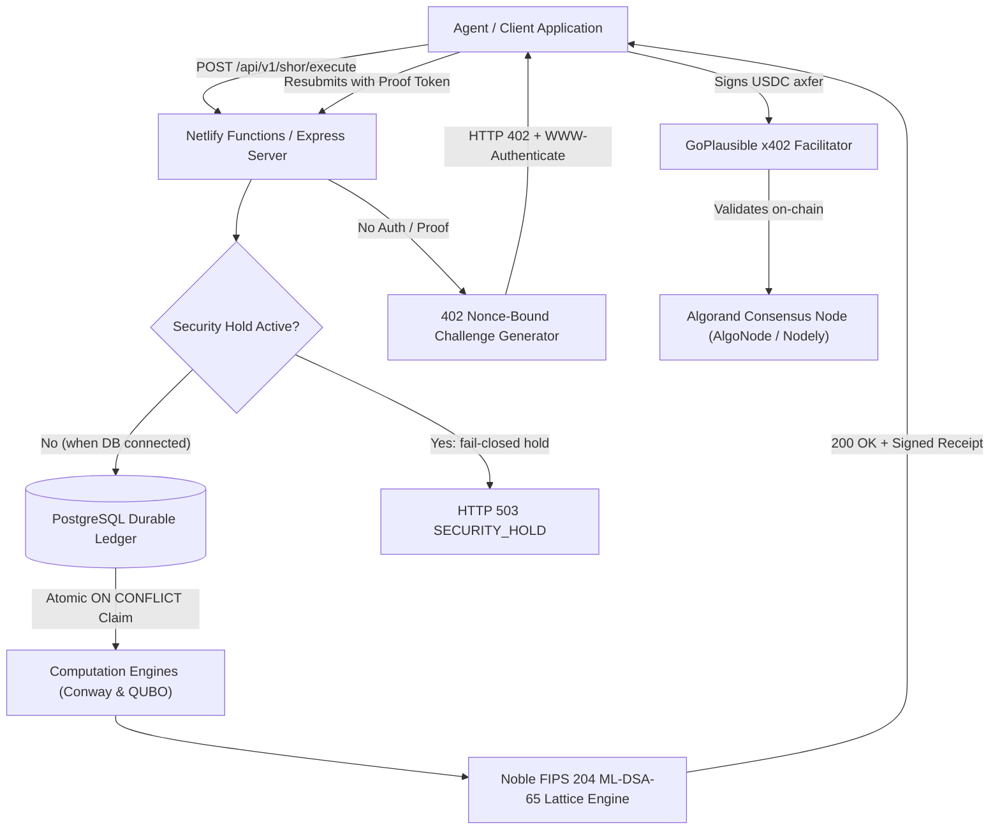

# SHOR x402 — MASTER ARCHITECTURE & REALITY MATRIX

**Project:** SHOR x402 Post-Quantum Autonomous Agent Commerce Hub  
**Chain:** Algorand MainNet & TestNet  
**Repository:** https://github.com/elon00/shor-x402  
**Audit Date:** 2026-11-03  
**Branch:** `repair/antigravity-master-mission-20261103`  

---

## 1. System Overview

SHOR x402 is an autonomous agent protocol and execution hub that implements HTTP 402 payment negotiation, post-quantum cryptographic (PQC) attestation, classical Quadratic Unconstrained Binary Optimization (QUBO) service planning, and Conway cellular automaton state transitions on the Algorand blockchain.

---

## 2. Component Taxonomy & Reality Map

| Component | File Path | Role | Status |
| :--- | :--- | :--- | :--- |
| **PQC Lattice Cryptography** | `src/utils/pqcCrypto.ts` | Real pure-TS NIST FIPS 204 ML-DSA-65 & FIPS 203 ML-KEM-768 | **PASS** |
| **Challenge Canonical Binding** | `src/lib/claimBinding.ts` `src/security/payment-claims.mjs` | Constant-time SHA-256 challenge serialization & expiration check | **PASS** |
| **Atomic Claim Consumption** | `src/lib/durableSettlement.ts` `src/security/durable-settlement.mjs` | Exactly-once consumption via SQL `ON CONFLICT DO NOTHING RETURNING id` | **PASS (Unit)** **BLOCKED (Live DB)** |
| **Facilitator Verifier** | `src/security/facilitator-verifier.mjs` | Strict contract validation between facilitator proof & Algorand consensus | **PASS** |
| **Conway & QUBO Engines** | `src/engines/paid-computation.mjs` | Deterministic classical Conway stepper & bounded exact QUBO solver | **PASS** |
| **Security Hold Gate** | `server.ts` `netlify/functions/shor-execute.ts` | Fail-closed HTTP 503 hold preventing unauthorized execution of stale payments | **PASS** |
| **Express Backend** | `server.ts` | Full-stack development & production Node API server | **PASS** |
| **Serverless Endpoints** | `netlify/functions/*.ts` | Edge payment challenge, verification, and service discovery | **PASS** |
| **Frontend Commerce Hub** | `src/components/*.tsx` | React 19 UI with wallet connector, packet inspector & status display | **PASS** |

---

## 3. Strict Algorand Network Separation

Authoritative parameters enforced across all verification layers:

| Parameter | MainNet | TestNet |
| :--- | :--- | :--- |
| **CAIP-2 Identifier** | `algorand:wGHE2pwdvd7S12BL5Fa+PRx3TF3QXDYODnakNVUtvpU=` | `algorand:SGO1GKSzyE7IEPItTxCByw9x8FmnrCDexi9/cOUJOiI=` |
| **Official USDC ASA ID** | `31566704` | `10458941` |
| **Recipient Address** | `TPLMGGFNG64LKOCKVB7ZMQH5AMSNMV4GLI7GCH4FY2XQEKSIGB77O6LCFM` | `TZ6ARRVMQEGRVMBISK7FYDPGIVYBLRSZUUS4A4DGPIEWDNJJ3KUSO66HUE` |
| **Transaction Type** | Asset Transfer (`axfer`) | Asset Transfer (`axfer`) |
| **Minimum Settlement** | 0.005 USDC (5,000 micro-USDC) | 0.005 USDC (5,000 micro-USDC) |
| **RPC / Indexer** | AlgoNode (`mainnet-idx.algonode.cloud`), Nodely (`mainnet-idx.4160.nodely.dev`) | AlgoNode (`testnet-idx.algonode.cloud`) |

---

## 4. Current Blocker Matrix

| Gate / Subsystem | Status | Root Cause / Missing External Resource | Resolution Path |
| :--- | :---: | :--- | :--- |
| **PostgreSQL Live Datastore** | **BLOCKED** | No persistent PostgreSQL instance configured in local or staging environment (`SHOR_TEST_DATABASE_URL` unset). | Provision managed PostgreSQL (e.g. Supabase / Neon / Cloud SQL) and apply `db/001_paid_execution_ledger.sql` and `db/002_result_journal.sql`. |
| **Live Facilitator Remote Verify** | **BLOCKED** | GoPlausible remote facilitator verification API endpoint requires merchant API credentials and registered webhook URL. | Complete merchant registration on GoPlausible x402 facilitator platform and configure `X402_FACILITATOR_API_KEY`. |
| **Live MainNet Payment Execution** | **BLOCKED** | Fail-closed `SECURITY_HOLD` (HTTP 503) intentionally maintained in source to prevent unauthorized spending or replay. | Lift hold only after PostgreSQL durable ledger and facilitator remote verify are verified live in staging. |
| **Algorand TestNet Release** | **BLOCKED** | Dedicated TestNet recipient account requires test ALGO and test USDC ASA 10458941 opt-in funding. | Fund test account from Algorand dispenser and execute automated TestNet test suite. |
| **NIST FIPS 203/204 PQC Suite** | **PASS** | Pure-TS ML-DSA-65 and ML-KEM-768 execute and verify 10/10 tests and 23/23 standalone cryptographic assertions. | Operational in local repository. |
| **Input-Derived Computation** | **PASS** | Real Conway cellular automaton and bounded QUBO exact solver integrated into server and serverless execution paths. | Operational in local repository. |
| **TypeScript & Production Build** | **PASS** | Zero TypeScript compiler diagnostics (`tsc --noEmit`); Vite production client and esbuild server build cleanly. | Operational in local repository. |
