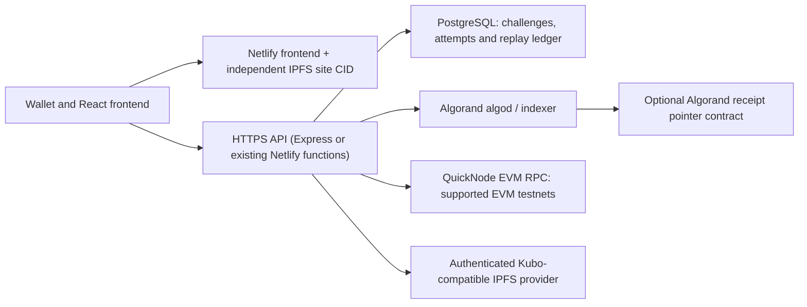

# SHOR Web3 implementation and release blueprint

Status as of 19 November 2026. The active checkout is `C:\Users\marti\shor-x402`. This differs from the older copy under this chat's `work` directory.

## 1. Architecture and scope



Netlify remains the selected frontend/backend host. Independent IPFS publishing is supported through a Kubo-compatible provider. The current Express server and PostgreSQL settlement ledger need a separate backend runtime. Publishing the frontend alone does not activate paid services. IPFS stores public, content-addressed receipts and site assets. PostgreSQL remains necessary for mutable claims, job state, and transaction uniqueness.

## 2. Repository structure

- `src/infrastructure/ipfs-store.mjs` validates a minimal public receipt and verifies the returned CID against its uploaded bytes.
- `src/infrastructure/storage-handler.mjs` authenticates receipt publishing.
- `src/infrastructure/chain-rpc.mjs` verifies a QuickNode EVM TestNet chain ID.
- `src/infrastructure/public-config.mjs` resolves the external HTTPS backend for IPFS builds.
- `src/security/testnet-evidence.mjs` records bounded, read-only live Algorand observations.
- `contracts/algorand/receipt-registry.*.teal` implements an optional creator-only pointer to the latest receipt.
- `scripts/algorand-deploy-plan.mjs` compiles fixed contract source and optionally prepares a wallet-signable unsigned creation transaction.
- `scripts/web3-check.mjs` runs the checks, builds, advisory audit and readiness reports.
- `netlify/functions/store-receipt.ts` and the Express storage route expose authenticated publishing.
- `scripts/build-ipfs.mjs` creates the portable static frontend; `netlify.toml` retains the selected HTTP/API host.

## 3. IPFS storage

Choose a Kubo-compatible provider, or run a local Kubo node. Configure `IPFS_RPC_URL` as its base origin/path, before `/api/v0`. `IPFS_RPC_TOKEN` is an optional provider bearer token. Providers requiring a different upload or authorization API need their own adapter.

Keep these values on the server. Set a separate random `SHOR_STORAGE_API_KEY` of at least 32 characters for authorized publishers. Do not put these values in variables beginning with `VITE_`.

The public JSON receipt contains exactly these fields:

```json
{
  "version": 1,
  "network": "eip155:84532",
  "transactionId": "<actual 0x transaction hash>",
  "resource": "/api/v1/shor/execute",
  "resultSha256": "<64 lowercase hexadecimal characters>",
  "issuedAt": "<UTC ISO timestamp with milliseconds>"
}
```

Algorand receipts use the canonical truncated CAIP-2 network identifier and a 52-character transaction ID. This schema is metadata. Its publication does not attest that payment or computation is correct.

`npm run storage:receipt -- --file=public-receipt.json` reviews a receipt without uploading. Adding `--publish-public` publishes it. The equivalent server endpoint is `POST /api/v1/storage/receipts` with bearer publisher authorization.

CID verification proves content addressing. Configure provider retention, monitor pins and retain another copy. Do not upload secrets, mnemonics, personal information or private agent transcripts.

## 4. Netlify hosting and portable IPFS build

Fleek Hosting was discontinued on January 31, 2026. Its former dashboard and documentation now redirect to a holding page. The user selected Netlify with independent IPFS storage on November 19, 2026. No Fleek publication should be attempted.

The existing Netlify configuration builds the frontend and packages the backend functions. It now routes `/api/v1/storage/receipts` to the authenticated receipt publisher. Set IPFS credentials and publisher authorization in Netlify's server-side environment settings. A new authenticated Netlify release and live smoke checks are still required.

For an additional IPFS copy of the frontend, set public `VITE_API_BASE_URL` to the HTTPS backend origin and run `npm run build:ipfs`. It uses relative asset paths for IPFS path gateways and defaults to this project's existing HTTPS Netlify API origin. Override VITE_API_BASE_URL for another backend. The existing public API answered HTTP 200 during this review, but its response contained legacy metadata; the new health/storage code still requires deployment. It does not publish files by itself. Pin the resulting website directory with your chosen provider and record the real directory CID after upload. Keep domain/DNSLink configuration independent from the provider.

Legacy `build:fleek` and `fleek:prepare` commands now return BLOCKED with the deprecation reason. No Fleek CLI installation or abandoned release workflow is required.

## 5. QuickNode and blockchain adapters

QuickNode's current supported-chain table does not list Algorand. Do not put an EVM JSON-RPC URL into an Algorand algod/indexer setting.

Use `QUICKNODE_EVM_RPC_URL` and `EVM_CHAIN=base-sepolia` (or `ethereum-sepolia`) for the implemented EVM connectivity adapter. It calls only `eth_chainId` and rejects the wrong chain. It does not claim wallet connectivity, contract deployment, cross-chain settlement or x402 EVM support.

Algorand retains separate `TESTNET_ALGOD_URL` and `TESTNET_INDEXER_URL` settings. The default public providers are AlgoNode. Private Algorand deployments should use dedicated providers and server-side credentials with rate limits.

## 6. Smart contracts and Scaffold

Scaffold-ETH 2 provides an Ethereum/EVM development environment. It cannot compile Algorand TEAL, Solana programs or every other blockchain VM. Replacing the existing React/Vite app with an additional Next.js monorepo is unnecessary for the current Algorand x402 flow.

The present native contract is a small, optional Algorand receipt registry. It lets only its creator update the latest 32-byte result digest and CID. It holds no user funds, performs no payment verification and accepts no update/delete calls. This feature is separate from x402 exact USDC transfers, which use the existing ASA and do not require a new token contract.

`npm run contract:prepare` verifies TestNet identity and compiles both TEAL programs. Set the public `TESTNET_DEPLOYER_ADDRESS` to also produce an unsigned creation transaction. Output is written under `contracts/algorand/artifacts`.

Compilation is not a contract execution test or deployment. Before submission, exercise creator permissions, malformed calls, rekey rejection, state updates and update/delete rejection on AlgoKit LocalNet. Review the account's creation minimum balance and fees, then sign through a wallet. Record the confirmed creation transaction ID and application ID and compare the deployed bytecode against the compiled programs. These steps remain blocked without LocalNet and wallet signing.

An EVM contract release should use a separate Scaffold-ETH/Hardhat or Foundry package, pinned compiler, native EVM tests and chain-specific deployment manifests. Additional chains must be enabled individually after those adapters and tests exist. This repository does not advertise universal-chain support.

## 7. Payment integrity and Gate 14

The previous runner generated its own challenge, constructed a facilitator proof from transaction metadata, signed a local result and used an in-memory Map as a database. Those observations could not establish a live end-to-end pass.

The corrected runner never signs or submits a transaction. A candidate confirmed transfer is inspected separately and cannot complete the payment, facilitator, execution or replay gates. The frontend no longer reuses an old transaction hash to manufacture a receipt. Preset wallet balances, historical seed receipts, invented faucet credits and incremented offline rounds have also been removed. Pera supports QR/mobile and browser-extension connection through its SDK. Saved public addresses are watch-only. Connection, account ownership proof, transaction consent and confirmed settlement are separate states; no wallet signing test was completed without the owner.

Exit 0 means the selected scope passed. Exit 1 means failed evidence or a check error. Exit 2 means required evidence/integration is missing. A five-check preflight pass does not mean Gate 14 passed.

Production paid execution remains on SECURITY_HOLD until the real signed paymentGroup, live facilitator verify/settle flow, persisted server challenge, delivered result and PostgreSQL replay checks are integrated.

## 8. Automated verification and beginner command

Run `npm run web3:check` from the active checkout. The desktop deliverable includes a PowerShell wrapper that finds this checkout, installs missing dependencies with the lockfile, runs the command and copies evidence to the chat's outputs directory.

The command performs no token minting, transfers, public IPFS uploads or deployment. Readiness blockers deliberately return a nonzero status. Reports live in `.web3-checks/latest.json` with per-check logs.

Unit fixtures test malicious and missing evidence. They are identified as fixtures and are not presented as live payment proofs. A missing PostgreSQL integration is a blocker even when its optional test skips. CodeQL is configured separately and must run on GitHub before a security scan can be claimed.

## 9. Acceptance scorecard (100 available points)

This is a release rubric, not an awarded score.

| Category | Points | Evidence required |
| --- | ---: | --- |
| Application and API | 10 | Build, regression, browser/mobile and backend smoke checks |
| Wallet and chain identity | 10 | Real wallet sessions, wrong-chain rejection, disconnect and QR tests |
| Payment authorization and settlement | 20 | Server challenge, actual signed group, facilitator settlement and confirmed payment |
| Durable database and replay handling | 15 | Real PostgreSQL concurrency, restart and duplicate-request tests |
| Smart contracts | 10 | Native execution/security tests, verified creation hash, app ID and bytecode |
| IPFS and retention | 10 | Verified live upload, gateway retrieval, monitored pin and recovery copy |
| Hosting and operations | 10 | Netlify release URL and IPFS CID, HTTPS API, monitoring, secrets, restore and rollback |
| Security and CI | 10 | Dependency audit, CodeQL run, secret scanning and required CI checks |
| Market documentation and pilot | 5 | Reproducible demo, support/privacy terms and external pilot acceptance |
| Total | 100 | All evidence above |

There is no universal production-readiness certificate. Award points only against recorded release evidence. Missing critical payment, replay or deployment checks prevent a production release regardless of the arithmetic.

## 10. Official references

- [Fleek discontinuation and IPFS migration](https://ipshipyard.com/blog/2026-ipfs-self-hosting-migration/)
- [QuickNode supported chains](https://www.quicknode.com/docs/platform/supported-chains-node-types)
- [IPFS privacy](https://docs.ipfs.tech/concepts/privacy-and-encryption/)
- [IPFS Kubo RPC API](https://docs.ipfs.tech/reference/kubo/rpc/)
- [Scaffold-ETH 2](https://docs.scaffoldeth.io/)
- [AlgoKit public deployment](https://dev.algorand.co/algokit/deployment/)
- [Algorand x402 exact scheme](https://github.com/x402-foundation/x402/blob/main/specs/schemes/exact/scheme_exact_algo.md)

The updated process health response separates provider configuration from live connectivity and does not invent a consensus round. Discovery resources are withheld while paid execution is disabled. The project index does not establish Bazaar registration. The browser helper timed out, so visual wallet approval and actual signing remain unverified.
